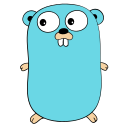
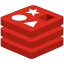
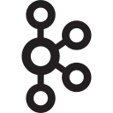
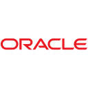

<picture>
  <source media="(prefers-color-scheme: dark)" srcset="assets/header-dark.svg">
  
</picture>

# Hey, I'm Darsh 👋

I build across the stack: **video systems, developer tools, and interactive machine learning.** From a verified video segment to a reviewable patch, I like making the whole path work.

I'm early in my open-source journey, bringing substantial implementation work to projects I care about.

  
  

**[Projects](#selected-builds)** &nbsp; / &nbsp; **[Open source](#open-source-work)** &nbsp; / &nbsp; **[Tools](#tools-behind-the-work)** &nbsp; / &nbsp; **[My koi](#a-little-public-activity-koi)**

## Selected builds

### ▶ [PeerShare](https://github.com/darshpatel1052/PeerShare)

A video platform with **adaptive HLS, creator tools, and verified peer delivery**. Browsers can opt into sharing video segments over WebRTC; the player checks their hashes before playback and retains HTTP delivery.

   

[Source ↗](https://github.com/darshpatel1052/PeerShare) · [Recorded product tour ↗](https://github.com/darshpatel1052/PeerShare#see-it-in-action)

### 🛠 [DevSentinel](https://github.com/darshpatel1052/Devsentinel)

A GitHub-native issue-repair assistant that **reproduces failures, investigates bounded fixes, verifies patches, and prepares draft pull requests** with evidence for review. Built as a locally runnable, single-operator tool; merging stays with the reviewer.

   

[Source ↗](https://github.com/darshpatel1052/Devsentinel) · [Local walkthrough ↗](https://github.com/darshpatel1052/Devsentinel/blob/main/docs/demo.md)

### ◈ [AlgoViz](https://github.com/Priyanshu-Shah/AlgoViz)

An interactive ML playground for **regression, KNN, decision trees, SVM, neural networks, clustering, and PCA**. Adjust parameters and explore how the algorithms behave.

**I implemented most of the application**, collaborating with the team in [Priyanshu's public repository](https://github.com/Priyanshu-Shah/AlgoViz).

  

[Source ↗](https://github.com/Priyanshu-Shah/AlgoViz) · [Frontend preview ↗](https://algovizz.web.app/) · [One of my merged PRs ↗](https://github.com/Priyanshu-Shah/AlgoViz/pull/1)

The hosted frontend is available; model training needs the backend, which was unreachable at the latest check. [Run it locally](https://github.com/Priyanshu-Shah/AlgoViz#-setup-instructions) for the complete experience.

<strong>A look inside PeerShare and AlgoViz</strong>

 

  
  

PeerShare: existing screenshot from the running application. AlgoViz: captured from its hosted frontend. These are real interfaces.

## Open-source work

### Mastra · OracleDB storage & vector integration

**I built the original major implementation of Mastra's OracleDB provider:** `OracleStore` and `OracleVector`, shared connection pooling, schema and migration support, metadata filtering, tests, and documentation.

[juliosouzam](https://github.com/juliosouzam) carried the work through follow-up changes and the final merged PR, explicitly crediting my original work and preserving its architecture.

**[My original implementation · #18011 ↗](https://github.com/mastra-ai/mastra/pull/18011)** &nbsp; · &nbsp; **[Merged follow-up · #19650 ↗](https://github.com/mastra-ai/mastra/pull/19650)**

**KnightVerse** — merged OpenAPI documentation and client SDK generation configuration. [PR #64 ↗](https://github.com/OpenKnight-Foundation/KnightVerse/pull/64)

## Tools behind the work

   &nbsp;
   &nbsp;
   &nbsp;
   &nbsp;
  <picture><source media="(prefers-color-scheme: dark)" srcset="assets/icons/nextjs-dark.svg"></picture> &nbsp;
   &nbsp;
   &nbsp;
   &nbsp;
  <picture><source media="(prefers-color-scheme: dark)" srcset="assets/icons/kafka-dark.svg"></picture> &nbsp;
  

Languages, frameworks, and infrastructure used in the projects and contributions above.

## A little public-activity koi

  <picture>
    <source media="(prefers-reduced-motion: reduce)" srcset="assets/koi/koi.png">
    
  </picture>
   
  My public GitHub activity, as a koi. Repository languages color its coat; contribution history shapes its growth and markings.

  <a href="https://github.com/yalongwastaken/git-koi">Made with git-koi</a> · <a href="assets/koi/koi.png">Still image</a> · <a href="https://github.com/darshpatel1052/darshpatel1052/actions/workflows/koi.yml">Nightly refresh</a>

---

<strong>Make it happen.</strong>

