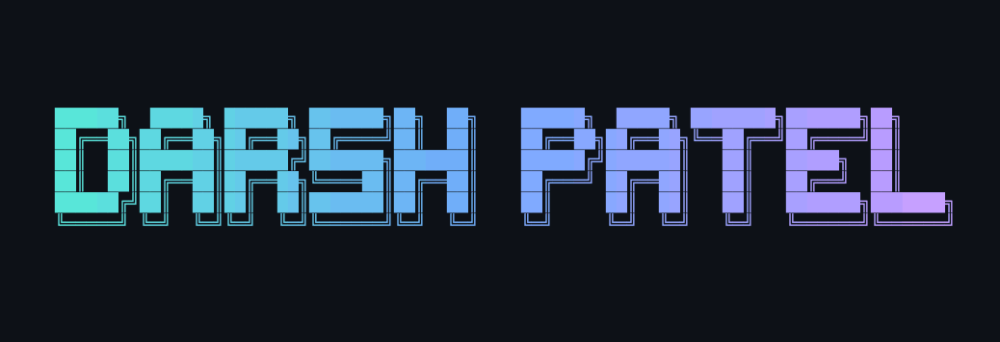
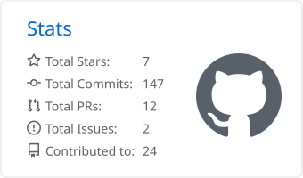
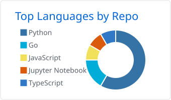

<table width="100%" role="presentation">
  <tr>
    <td width="58%" valign="top">
      <h2>Hey, I'm Darsh 👋</h2>
      
An <strong>AI &amp; Data Science student at IIT Jodhpur</strong>. I like making things I'd want to use and figuring out how other people built theirs.

      <ul>
        <li>🔎 Reading source code and following another “why?”</li>
        <li>🛠️ Built with folks at <strong>Oracle</strong> and <strong>Reetape</strong>.</li>
        <li>♟️ <strong>LeetCode Knight</strong> · former CS teaching assistant.</li>
        <li>💬 Happy to talk code or trade a good idea.</li>
      </ul>

  
  
  
  

    </td>
    <td width="42%" valign="middle" align="center">
<picture>
  <source media="(prefers-reduced-motion: reduce)" srcset="assets/hero/blackhole-static.png">
  
</picture>
 
<picture>
  <source media="(prefers-reduced-motion: reduce) and (prefers-color-scheme: dark)" srcset="assets/widgets/quote-dark-static.png">
  <source media="(prefers-reduced-motion: reduce)" srcset="assets/widgets/quote-light-static.png">
  <source media="(prefers-color-scheme: dark)" srcset="assets/widgets/quote-dark.svg">
  
</picture>
      — <a href="https://engineering.yale.edu/academic-study/departments/computer-science/about/epigrams-programming">Alan Perlis</a>
    </td>
  </tr>
</table>

## 🛠️ A few things I've made

- **[PeerShare](https://github.com/darshpatel1052/PeerShare)** — A video-sharing app where browsers can share pieces of a stream with each other. The player checks those pieces before playing them.
- **[DevSentinel](https://github.com/darshpatel1052/Devsentinel)** — An assistant that digs into GitHub issues, tries a fix, and brings back a draft PR to review.
- **[AlgoViz](https://github.com/Priyanshu-Shah/AlgoViz)** — An ML playground we built to make the ideas easier to see. Change the data or model settings and explore what happens.

A peek at PeerShare and AlgoViz

 

  
  

## 🧰 My toolbox

<picture>
  <source media="(prefers-color-scheme: dark)" srcset="assets/widgets/skills-dark.svg">
  
</picture>

A few more I've used along the way

 

  
  
  
  
  
  
  
  
  
  
  
  
  
  
  
  
  
  
  
  
  
  
  
  
  
  
  
  
  
  
  
  
  
  
  

## 🌱 Open source

One contribution I'm proud of: **OracleDB support in Mastra**. I wrote the original provider; [juliosouzam](https://github.com/juliosouzam) took the follow-up through to merge, keeping the architecture and crediting the original work.

**[Original implementation · #18011 ↗](https://github.com/mastra-ai/mastra/pull/18011)** &nbsp; · &nbsp; **[Merged follow-up · #19650 ↗](https://github.com/mastra-ai/mastra/pull/19650)**

I also contributed OpenAPI docs and SDK generation to **KnightVerse**, merged in [#64 ↗](https://github.com/OpenKnight-Foundation/KnightVerse/pull/64).

## 📊 Around GitHub

  <a href="https://github.com/darshpatel1052?tab=repositories">
    <picture>
      <source media="(prefers-color-scheme: dark)" srcset="assets/widgets/github-dark.svg">
      
    </picture>
  </a>
  <a href="https://github.com/darshpatel1052?tab=repositories">
    <picture>
      <source media="(prefers-color-scheme: dark)" srcset="assets/widgets/languages-dark.svg">
      
    </picture>
  </a>

## 🐍 Contributions

<table>
  <tr>
    <td width="84%">
      <picture>
        <source media="(prefers-reduced-motion: reduce) and (prefers-color-scheme: dark)" srcset="assets/activity/snake-dark-static.svg">
        <source media="(prefers-reduced-motion: reduce)" srcset="assets/activity/snake-light-static.svg">
        <source media="(prefers-color-scheme: dark)" srcset="assets/activity/snake-dark.svg">
        
      </picture>
    </td>
    <td width="16%" align="center">
      <picture>
        <source media="(prefers-reduced-motion: reduce)" srcset="assets/koi/koi.png">
        
      </picture>
    </td>
  </tr>
</table>

[Static graph](assets/activity/snake-light-static.svg)
