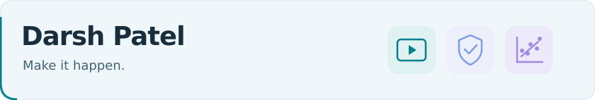
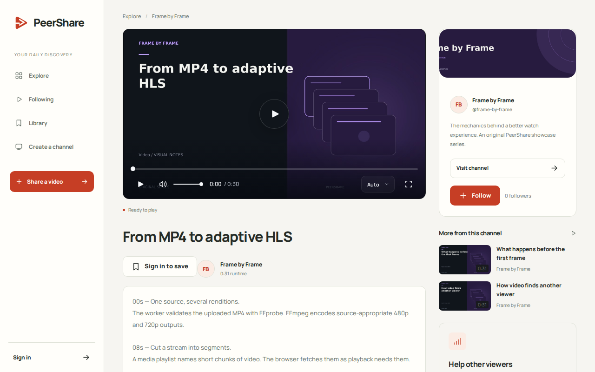
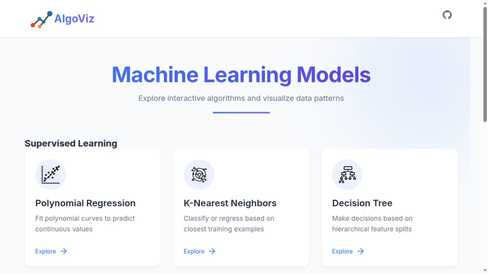

<picture>
  <source media="(prefers-reduced-motion: reduce) and (prefers-color-scheme: dark)" srcset="assets/header-dark-static.svg">
  <source media="(prefers-reduced-motion: reduce)" srcset="assets/header-light-static.svg">
  <source media="(prefers-color-scheme: dark)" srcset="assets/header-dark.svg">
  
</picture>

> “What I cannot create, I do not understand.”
> — [Richard Feynman](https://calteches.library.caltech.edu/684/1/ES65.2.2002.pdf)

I'm Darsh, a **software generalist** studying AI & Data Science at **IIT Jodhpur**. I like knowing what the abstraction is hiding: the query plan underneath an ORM, the network behind an API, the data behind a model.

I've worked on database infrastructure at **Oracle** and real-time voice agents at **Reetape**. My projects move between backend engineering, distributed systems, AI, and whatever else the problem needs. The interesting part is getting far enough into a system that it stops feeling like a black box.

- 🔬 Currently exploring **data-centric learning for small vision-language models** — better supervision, pseudo-label filtering, and verification.
- 🧠 Other rabbit holes: **agent architectures, databases, distributed systems, and algorithms**.
- ♟️ [LeetCode Knight](https://leetcode.com/u/darsh_0p/) · previously researched controllable video-weather translation at IIT Hyderabad.

  
  
  
  

## 🧰 Stack

<!-- STACK:START -->

### Languages

  
  
  
  
  
  
  
  

### Backend & web

  
  
  
  
  
  
  
  
  
  
  
  

### Databases & messaging

  
  
  
  
  
  
  
  
  
  

### AI & ML

  
  
  
  
  
  
  
  
  
  

### Cloud & delivery

  
  
  
  
  
  

### Tools & observability

  
  
  
  
  
  
  

<!-- STACK:END -->

**Under the hood:** event-driven systems · transactional outboxes · connection pooling · vector search · container isolation · model training & evaluation · real-time audio/video · CI/CD & observability.

## 🚀 Things I've built

### ▶ [PeerShare](https://github.com/darshpatel1052/PeerShare)

A video platform with **adaptive HLS, creator tools, and verified peer delivery**. Browsers can opt into sharing video segments over WebRTC; the player checks their hashes before playback and retains HTTP delivery.

   

[Source ↗](https://github.com/darshpatel1052/PeerShare) · [Recorded product tour ↗](https://github.com/darshpatel1052/PeerShare#see-it-in-action)

### 🛠 [DevSentinel](https://github.com/darshpatel1052/Devsentinel)

A GitHub-native issue-repair assistant that **reproduces failures, investigates bounded fixes, verifies patches, and prepares draft pull requests** with evidence for review. Built as a locally runnable, single-operator tool; merging stays with the reviewer.

   

[Source ↗](https://github.com/darshpatel1052/Devsentinel) · [Local walkthrough ↗](https://github.com/darshpatel1052/Devsentinel/blob/main/docs/demo.md)

### ◈ [AlgoViz](https://github.com/Priyanshu-Shah/AlgoViz)

Co-developed an interactive ML lab for **regression, KNN, decision trees, SVM, neural networks, clustering, and PCA**, with core implementation across the React frontend and Flask backend. Change the data or a hyperparameter and inspect decision boundaries, clusters, and training curves.

   

[Team repository ↗](https://github.com/Priyanshu-Shah/AlgoViz) · [Explore the interface ↗](https://algovizz.web.app/)

<strong>A look inside PeerShare and AlgoViz</strong>

 

  
  

PeerShare: existing screenshot from the running application. AlgoViz: captured from its hosted frontend. These are real interfaces.

## 🔧 Open source

### Mastra · OracleDB storage & vector integration

**I built the original major implementation of Mastra's OracleDB provider:** `OracleStore` and `OracleVector`, shared connection pooling, schema and migration support, metadata filtering, tests, and documentation.

[juliosouzam](https://github.com/juliosouzam) carried the work through follow-up changes and the final merged PR, explicitly crediting my original work and preserving its architecture.

**[My original implementation · #18011 ↗](https://github.com/mastra-ai/mastra/pull/18011)** &nbsp; · &nbsp; **[Merged follow-up · #19650 ↗](https://github.com/mastra-ai/mastra/pull/19650)**

**KnightVerse** — merged OpenAPI documentation and client SDK generation configuration. [PR #64 ↗](https://github.com/OpenKnight-Foundation/KnightVerse/pull/64)

## 🐍 Contributions

<table>
  <tr>
    <td width="84%">
      <picture>
        <source media="(prefers-reduced-motion: reduce) and (prefers-color-scheme: dark)" srcset="assets/activity/snake-dark-static.svg">
        <source media="(prefers-reduced-motion: reduce)" srcset="assets/activity/snake-light-static.svg">
        <source media="(prefers-color-scheme: dark)" srcset="assets/activity/snake-dark.svg">
        
      </picture>
    </td>
    <td width="16%" align="center">
      <picture>
        <source media="(prefers-reduced-motion: reduce)" srcset="assets/koi/koi.png">
        
      </picture>
    </td>
  </tr>
</table>

[Static graph](assets/activity/snake-light-static.svg) · [Portfolio](https://www.darshpatel.dev/) · [Résumé](https://www.darshpatel.dev/Darsh_Resume.pdf)
